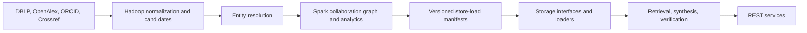
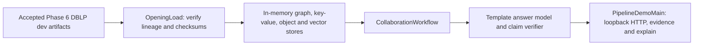
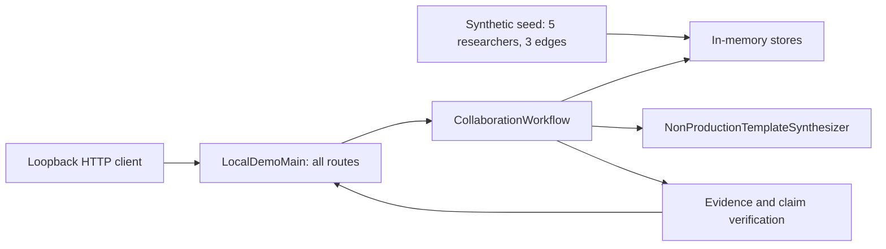

# Architecture

ScholarChain separates data processing from runtime queries. Scala modules exchange
versioned records and manifests rather than importing pipeline implementations.

The diagram describes the intended architecture, not a claim of live deployment.
The Hadoop and Spark paths have local evidence; successful EMR Spark execution is
outstanding. Concrete AWS adapters exist but live loading and production operation
are not established by the local demo.

The new local profile connects the accepted real-data artifacts to the same query
workflow. It runs the existing verification/load logic before opening HTTP:

`pipelineDemoClasspath` supplies storage's optional reader libraries only to this
separate local process. Normal services packaging and module dependencies keep
their existing boundaries. No test implementation is imported into main code.
The old synthetic profile is also preserved:

Demo authentication uses a public key checked against a committed digest. Production
entry points use `ProductionSettings.forLauncher`, reject missing dependencies, and
must not silently substitute the demo. The Secrets Manager key source and production
answer/embedding providers are outstanding. The demo is a single process/replica;
its memory is not a durable or distributed store.

Internal dependencies: core has none; entityResolution -> core; hadoop -> core and
entityResolution; sparkAnalytics -> core; storage -> core; rag -> core and storage
ports; services -> core, rag, storage. Cross-module tests are test scope only.
The version ledger and dependency-scope checks enforce the build boundary.

The historical workflow is Claude orchestrator -> owning specialist -> independent
review -> human acceptance/commit. Codex took over local completion on November 23
at the user's request; that takeover is disclosed in the final report. Independent
closeout reviewers now approve the bounded local checkpoint after the owning
service engineer repaired the throwing-factory failed-start cleanup path. Human
acceptance remains pending. See the [review](agent-runs/integration-02/review-report.md)
and [test report](agent-runs/integration-02/test-report.md). The post-repair local gate
passed; this is not deployment approval.
